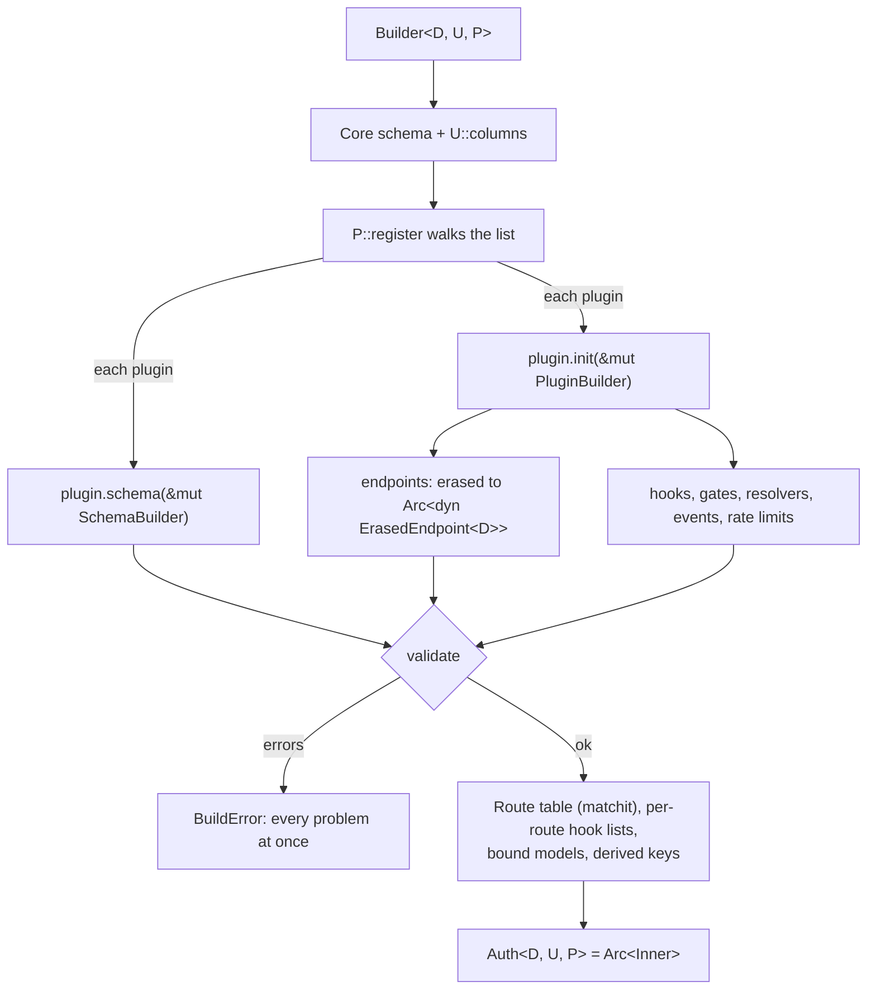
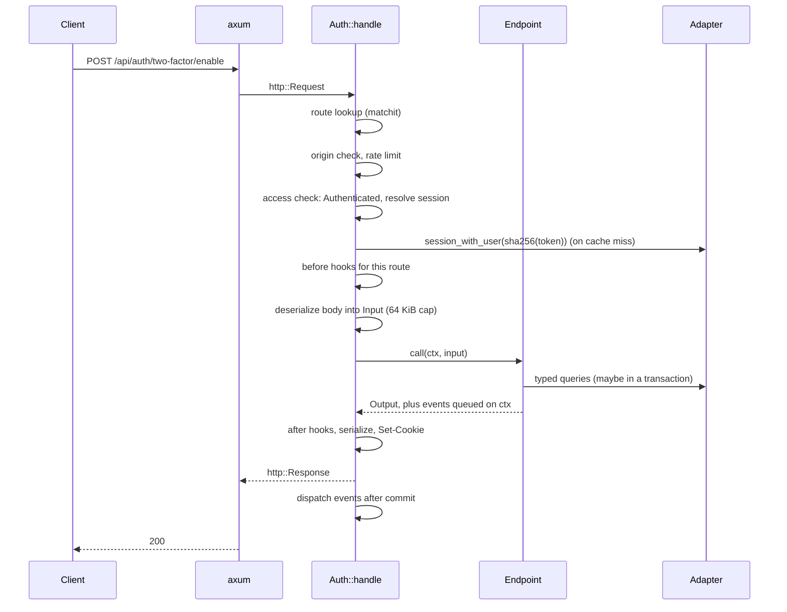

# Internals

How fastauth works under the hood, in the order things happen: the type-level plugin
list while you compile, the build step at startup, then the path of a request.

## The type-level plugin list

### The list

```rust
pub struct Nil;
pub struct Cons<H, T>(Arc<H>, T);

macro_rules! plugins {
    () => { Nil };
    ($head:ty $(, $tail:ty)*) => { Cons<$head, plugins![$($tail),*]> };
}
// plugins![TwoFactor, Organization] == Cons<TwoFactor, Cons<Organization, Nil>>
```

The builder starts at `Builder<D, U, Nil>`. Each `.plugin(p)` appends at the end through
an `Append` trait, so the type reads in registration order and matches the `plugins![..]`
alias you write:

```rust
impl<T> Append<T> for Nil { type Out = Cons<T, Nil>; }
impl<H, Tail: Append<T>, T> Append<T> for Cons<H, Tail> { type Out = Cons<H, Tail::Out>; }
```

### Finding a plugin by type

`Has<P, I>` means "list contains `P` at position `I`". `I` is a type-level index (`Here`,
`There<Here>`, `There<There<Here>>`, ...):

```rust
pub struct Here;
pub struct There<I>(PhantomData<I>);

impl<P, T> Has<P, Here> for Cons<P, T> { /* head */ }
impl<P, H, T: Has<P, I>, I> Has<P, There<I>> for Cons<H, T> { /* recurse into tail */ }
```

The two impls don't overlap because their index types differ. When you write
`auth.plugin::<TwoFactor, _>()`, the compiler searches for the one `I` that makes the
bound hold. That's why the `_` is always enough, and why a plugin type can appear only
once in a list (twice would make `I` ambiguous: registering the same plugin twice is a
compile error by construction). Lookup compiles to a fixed field access. There is no
runtime search.

When nothing matches, the error comes from `#[diagnostic::on_unimplemented]` on `Has`, which
is why it reads "plugin `Organization` is not registered on this auth instance" instead of
"the trait `Has<Organization, _>` is not implemented for `Nil`".

### Dependencies

`Plugin::Requires` is a tuple of plugin types. `.plugin(p)` carries the bound
`P::Requires: Satisfied<CurrentList, I>`:

```rust
impl<L> Satisfied<L, ()> for () {}
impl<L, A, IA> Satisfied<L, (IA,)> for (A,) where L: Has<A, IA> {}
impl<L, A, B, IA, IB> Satisfied<L, (IA, IB)> for (A, B) where L: Has<A, IA> + Has<B, IB> {}
// ... up to 8, generated by a macro
```

Because the bound is checked against the list *before* the new plugin is appended, a
dependency registered later fails too. That's what makes `ctx.plugin::<Organization>()`
inside `OrgBilling` infallible.

### Typed plugin fields on the user

`PluginSet` is implemented recursively for the list. Its associated `UserExt` is a nested
tuple of every plugin's `UserFields`, parallel to the list:

```rust
impl PluginSet for Nil { type UserExt = (); }
impl<H: Plugin, T: PluginSet> PluginSet for Cons<H, T> {
    type UserExt = (H::UserFields, T::UserExt);
    fn decode_user(row: &Row) -> Result<Self::UserExt, AuthError> {
        Ok((H::UserFields::decode(row)?, T::decode_user(row)?))
    }
}
```

`Has` gets a second method that walks the same index into that tuple, so
`user.plugin::<TwoFactor, _>()` returns `&TwoFactorUser` with no lookup and no
`Any` downcast. All plugin fields are decoded once, when the session is loaded; for typical
plugins that's a few bools and short strings.

### What plugins see: erased, but still typed

Inside a plugin, `Auth`'s plugin list is unknown (a plugin can't name the app's alias). So
`ctx` exposes the parts a plugin *can* name:

- `ctx.session().user` is a `UserView`: the core fields plus the raw row. A plugin reads its
  own columns with `user.fields::<TwoFactorUser>()`, which decodes them by column position.
- `ctx.plugin::<P>()` looks up a plugin by `TypeId` in a map built at startup. It's only
  infallible for plugins in `Requires`; `ctx.try_plugin::<P>()` is the `Option` version.

The type-level list gives compile-time guarantees to the **app**. Plugins get the runtime
map, backed by the compile-time `Requires` check.

## The build step

`.build()` runs once at startup. It turns the typed configuration into plain runtime data
structures, so nothing on the request path is generic over the plugin list.



What validation catches: duplicate tables, columns, routes and error codes (each names both
owners); typed hooks on unregistered endpoints; config that needs a mailer without one;
malformed URLs; short secrets.

Work done here so it isn't done per request:

- **Routes** go into a `matchit` router: lookup is a radix-tree walk over the path.
- **Hooks are attached to routes.** Every route stores the indices of the hooks that match
  it, so a request runs exactly its hooks and never evaluates matchers for the others.
- **Models are bound to tables.** Each `#[derive(Model)]` type gets its column positions
  resolved against the merged schema, so decoding a row is index reads, not name lookups.
- **SQL is rendered once per shape.** The sqlx adapter caches the SQL text for each
  `(operation, table, columns, filter shape)`, and sqlx caches the prepared statement per
  connection. A steady-state query neither builds strings nor re-prepares.
- **Keys are derived** with HKDF ([Security](09-security.md#secrets)).

`Auth` is an `Arc<Inner>`; cloning it into axum state or a spawned task is one atomic
increment.

## The request path



The step from the route table to the endpoint is one virtual call into the erased
endpoint, which then calls the concrete, fully monomorphized `call`. There's one heap
allocation for the boxed future. Next to a database round trip both are noise, and that's
the price of keeping plugin generics out of handler compile times.

## The session hot path

`get_session` runs on every authenticated request, so it has three tiers, cheapest first:

| Tier | Enabled by | Work | I/O |
|---|---|---|---|
| 1. Cookie cache | `.cookie_cache(5 min)` | HMAC-SHA256 verify, decode a compact binary payload | none |
| 2. Secondary storage | `.secondary_storage(..)` | HMAC verify, one `GET` | one Redis round trip |
| 3. Database | always | HMAC verify, one indexed `SELECT .. JOIN` on `token_hash` | one DB round trip |

Every tier starts with the cookie signature check, so garbage cookies are rejected
without I/O.

The database query is a single statement, prepared once:

```sql
SELECT s.id, s.user_id, s.expires_at, s.created_at, s.updated_at, ...,
       u.id, u.email, u.email_verified, u.name, ..., u.plan, u.two_factor_enabled
FROM session s JOIN "user" u ON u.id = s.user_id
WHERE s.token_hash = $1 AND s.expires_at > now()
```

The column list is rendered at build time from the merged schema, so plugin columns come
along without an extra query.

**Sliding expiry without write amplification.** A session is extended only when
`now - updated_at > update_age` (default one day), so an active user causes one
`UPDATE` per day, not one per request. The update is conditional
(`WHERE id = $1 AND updated_at = $2`), so concurrent requests extend it once and nobody
blocks.

**Revocation latency.** Tier 1 can't see a revocation until the cache cookie expires
(5 minutes in the example). Tiers 2 and 3 see it immediately. Endpoints that must not
trust a cached session (`Fresh` access, and anything that changes credentials) always
go to tier 2 or 3.

## Compile time and binary size

The generic parts are the builder, `Has`/`Append`/`Satisfied` resolution, and each
plugin's `init`, monomorphized once for the app's adapter. Handlers that take
`Session<AppAuth>` mention the alias but don't instantiate anything new per handler. Plugin
lists are short (under 15 in practice), and trait resolution over a list that long is
cheap. The spike type-checks in well under a second.

The cost to watch is error messages: a mismatched alias prints both full `Cons<..>` types.
`fastauth::assert_plugins!(AppAuth, auth)` (a compile-time assertion with a shorter message)
is a cheap fix if that turns out to be a problem.

## What the spike proves

`spike/typed-plugins` is about 1,100 lines of library code with no dependencies beyond serde. It isn't the
real crate (no crypto, no SQL, simplified names), but it compiles the type-level design on
rustc 1.100 and tests it:

| Claim | Proven by |
|---|---|
| `Has<P, _>` infers the index; `auth.plugin::<P, _>()` works | doctest at the top of `src/lib.rs` |
| Missing plugin is a compile error with a readable message | `compile_fail` doctest |
| Missing or later-registered dependency is a compile error at `.plugin(..)` | two `compile_fail` doctests |
| Extension trait methods only exist with their plugin | `compile_fail` doctest, `server_side_api_skips_json` test |
| Plugin user columns decode into typed structs | `http_flow_updates_typed_plugin_fields` |
| Erased endpoints serve JSON; typed calls skip JSON | `http_flow_..`, `server_side_api_skips_json` |
| Dependent plugin reads its dependency without a fallible lookup | `plugin_reads_its_dependency_without_fallible_lookup` |
| Schema merges core, app and plugin columns, and reports clashes with both owners | `schema_merges_..`, `column_clash_is_a_build_error` |

Run it with `cd spike/typed-plugins && cargo test`. The error messages quoted in
[Sessions](04-sessions.md) and [Plugins](05-plugins.md) are its real output.

What it doesn't prove yet: the `Access` typestate on `Ctx`, `#[derive(Model)]`'s typed
columns, `.in_tx(&tx)` transaction sharing, and the axum `FromRequestParts` impl for
`Session<A>` generic over the alias. Those are standard Rust patterns with less risk, and
they're the first things to build in v0.1.
