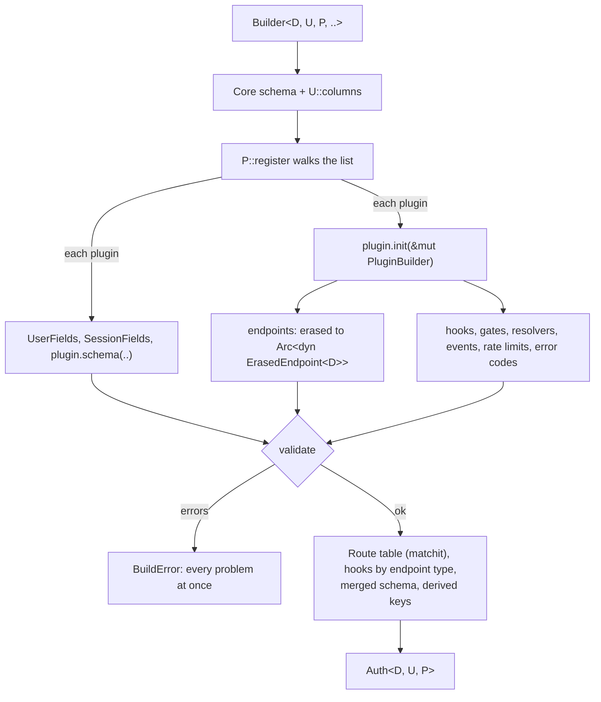
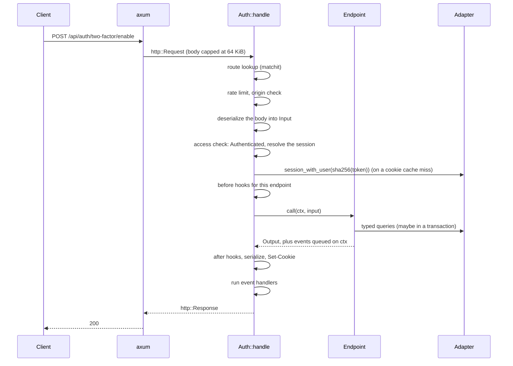

# Internals

How fastauth works under the hood, in the order things happen: the type-level plugin
list while you compile, the build step at startup, then the path of a request. The code
excerpts are from `fastauth-core`.

## The type-level plugin list

### The list

```rust
pub struct Nil;
pub struct Cons<H, T>(pub(crate) Arc<H>, pub(crate) T);
macro_rules! plugins {
    () => { $crate::Nil };
    ($head:ty $(, $tail:ty)* $(,)?) => { $crate::Cons<$head, $crate::plugins![$($tail),*]> };
}
```

`plugins![TwoFactor, Organization]` is `Cons<TwoFactor, Cons<Organization, Nil>>`. The
builder starts at `Nil`. Each `.plugin(p)` appends at the end through an `Append` trait,
so the type reads in registration order and matches the `plugins![..]` alias you write:

```rust
impl<T> Append<T> for Nil {
    type Out = Cons<T, Nil>;
impl<H, Tail: Append<T>, T> Append<T> for Cons<H, Tail> {
    type Out = Cons<H, Tail::Out>;
```

### Finding a plugin by type

`Has<P, I>` means "the list contains `P` at position `I`". `I` is a type-level index (`Here`,
`There<Here>`, `There<There<Here>>`, ...):

```rust
pub struct Here;
pub struct There<I>(PhantomData<I>);

impl<P: Plugin, T: PluginSet> Has<P, Here> for Cons<P, T> {
impl<P: Plugin, H: Plugin, T: Has<P, I>, I> Has<P, There<I>> for Cons<H, T> {
```

The two impls don't overlap because their index types differ. When you write
`session.user.plugin::<TwoFactor, _>()`, the compiler searches for the one `I` that makes
the bound hold. That's why the `_` is always enough, and why a plugin type can appear only
once in a list (twice would make `I` ambiguous; `.build()` also refuses a plugin registered
twice). Lookup compiles to a fixed field access. There is no runtime search.

When nothing matches, the error comes from `#[diagnostic::on_unimplemented]` on `Has`:

```rust
#[diagnostic::on_unimplemented(
    message = "plugin `{P}` is not registered on this auth instance",
    label = "`{P}` is not in this plugin list",
    note = "register it with `.plugin(...)` on the builder, before any plugin that requires it, and list it in your `plugins![..]` alias"
)]
pub trait Has<P: Plugin, I>: PluginSet {
```

That's why the error reads "plugin `TwoFactor` is not registered on this auth instance"
instead of "the trait `Has<TwoFactor, _>` is not implemented for `Nil`"
([Sessions](04-sessions.md#typed-plugin-data-on-the-user) and
[Plugins](05-plugins.md#depending-on-another-plugin) show real output).

### Dependencies

`Plugin::Requires` is a tuple of plugin types. `.plugin(p)` carries the bound
`Pl::Requires: Satisfied<P, I>`, where `P` is the list so far:

```rust
impl<L> Satisfied<L, ()> for () {}
macro_rules! satisfied {
    ($(($p:ident, $i:ident)),+) => {
        impl<L, $($p: Plugin, $i),+> Satisfied<L, ($($i,)+)> for ($($p,)+) where $(L: Has<$p, $i>),+ {}
    };
}
```

The macro implements it for tuples of up to six plugins. Because the bound is checked
against the list *before* the new plugin is appended, a dependency registered later fails
too. That's what makes `ctx.plugin::<Organization>()` inside a plugin that requires it
infallible.

### Typed plugin fields on the user

`PluginSet` is implemented recursively for the list. Its associated `UserExt` is a nested
tuple of every plugin's `UserFields`, parallel to the list:

```rust
impl<H: Plugin, T: PluginSet> PluginSet for Cons<H, T> {
    type UserExt = (H::UserFields, T::UserExt);
    type SessionExt = (H::SessionFields, T::SessionExt);
    fn decode_user(row: &Row) -> Result<Self::UserExt, DecodeError> {
        Ok((H::UserFields::decode(row)?, T::decode_user(row)?))
    }
```

`Has` has methods that walk the same index into that tuple, so
`user.plugin::<TwoFactor, _>()` returns `&TwoFactorUser` with no lookup and no `Any`
downcast. All plugin fields are decoded once, when the session is loaded; for typical
plugins that's a few bools and short strings.

### What plugins see: erased, but still typed

Inside a plugin, `Auth`'s plugin list is unknown (a plugin can't name the app's alias). So
`ctx` exposes the parts a plugin *can* name:

- `ctx.session().user` is a `UserView`: the core fields plus the raw row. A plugin reads its
  own columns with `user.fields::<TwoFactorUser>()`, which decodes them from the row.
- `ctx.plugin::<P>()` looks up a plugin by `TypeId` in a map built at startup. It's only
  infallible for plugins in `Requires`; `ctx.try_plugin::<P>()` is the `Option` version.
  `AuthInstance::try_plugin::<P>()` does the same for code outside a request, such as an
  axum extractor that's generic over the auth instance.

The type-level list gives compile-time guarantees to the **app**. Plugins get the runtime
map, backed by the compile-time `Requires` check. `crates/fastauth-core/src/doctests.rs`
holds `compile_fail` doctests for each guarantee: a missing plugin, a missing or
later-registered dependency, and an alias in the wrong order.

## The build step

`.build()` runs once at startup. It turns the typed configuration into plain runtime data
structures, so nothing on the request path is generic over the plugin list.



What validation catches: duplicate columns, routes and error codes (each names both
owners), a plugin registered twice, hooks on unregistered endpoints, email verification
without a mailer, a `base_url` that isn't http(s), and short secrets. The app's own
`.configure(..)` and `.on(..)` registrations run as the owner `app`, after the plugins.

Work done here so it isn't done per request:

- **Routes** go into a `matchit` router: lookup is a radix-tree walk over the path.
- **Hooks are stored by endpoint type**, so a request runs exactly its endpoint's hooks
  and never looks at the others.
- **SQL is rendered once per shape.** The sqlx adapter caches the SQL text for each
  `(operation, table, columns, filter shape)`, and sqlx caches the prepared statement per
  connection. A steady-state query neither builds strings nor re-prepares.
- **Keys are derived** with HKDF ([Security](09-security.md#secrets)).

`Auth` is two `Arc`s, the plugin list and the shared state, so cloning it into axum state
or a spawned task is cheap.

## The request path



The step from the route table to the endpoint is one virtual call into the erased
endpoint, which then calls the concrete, fully monomorphized `call`. There's one heap
allocation for the boxed future. Next to a database round trip both are noise, and that's
the price of keeping plugin generics out of handler compile times.

## The session hot path

`get_session` runs on every authenticated request, so it has two tiers, cheapest first:

| Tier | Enabled by | Work | I/O |
|---|---|---|---|
| 1. Cookie cache | `.cookie_cache(5 min)` | HMAC-SHA256 verify, decode the cached session | none |
| 2. Database | always | HMAC verify, one indexed `SELECT .. JOIN` on `token_hash` | one DB round trip |

Both start with the cookie signature check, so garbage cookies are rejected without I/O.
Requests without a session cookie then go through the session resolvers, such as the API
key plugin's. A Redis tier between the two is [planned](01-overview.md#planned).

On sqlx, the database lookup is a single statement, prepared once:

```sql
SELECT s."id", s."token_hash", ..., u."id", u."email", ..., u."plan", u."two_factor_enabled"
FROM "session" AS s JOIN "user" AS u ON u."id" = s."user_id"
WHERE s."token_hash" = $1 LIMIT 1
```

The column list is rendered from the merged schema, so plugin columns come along without an
extra query. An expired session is deleted when it's found.

**Sliding expiry without write amplification.** A session is extended only when
`now - updated_at > update_age` (default one day), so an active user causes one
`UPDATE` per day, not one per request. The update is conditional
(`WHERE id = $1 AND updated_at = $2`), so concurrent requests extend it once and nobody
blocks.

**Revocation latency.** Tier 1 can't see a revocation until the cache cookie expires
(5 minutes in the example). Tier 2 sees it immediately.

## Compile time and binary size

The generic parts are the builder, `Has`/`Append`/`Satisfied` resolution, and each
plugin's `init`, monomorphized once for the app's adapter. Handlers that take
`Session<AppAuth>` mention the alias but don't instantiate anything new per handler. Plugin
lists are short, and trait resolution over a list that long is cheap.

The cost to watch is error messages: a mismatched alias prints both full `Cons<..>` types,
and rustc may write a very long type to a file instead of printing it.

`spike/typed-plugins` is the prototype this design was proven on before the real crates
existed. It's kept for history; the real crates and their tests are the reference now.
